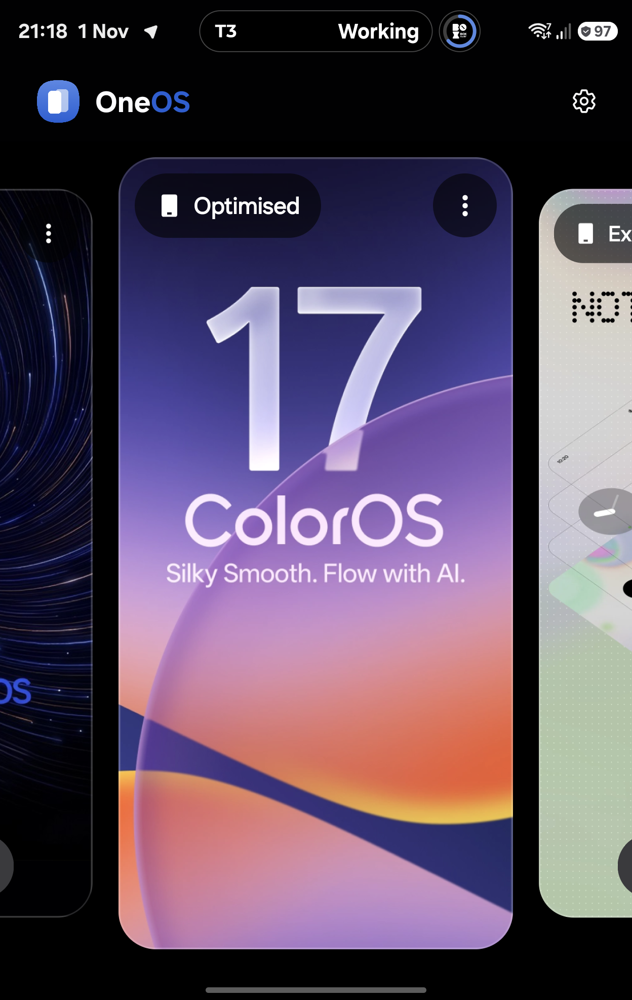
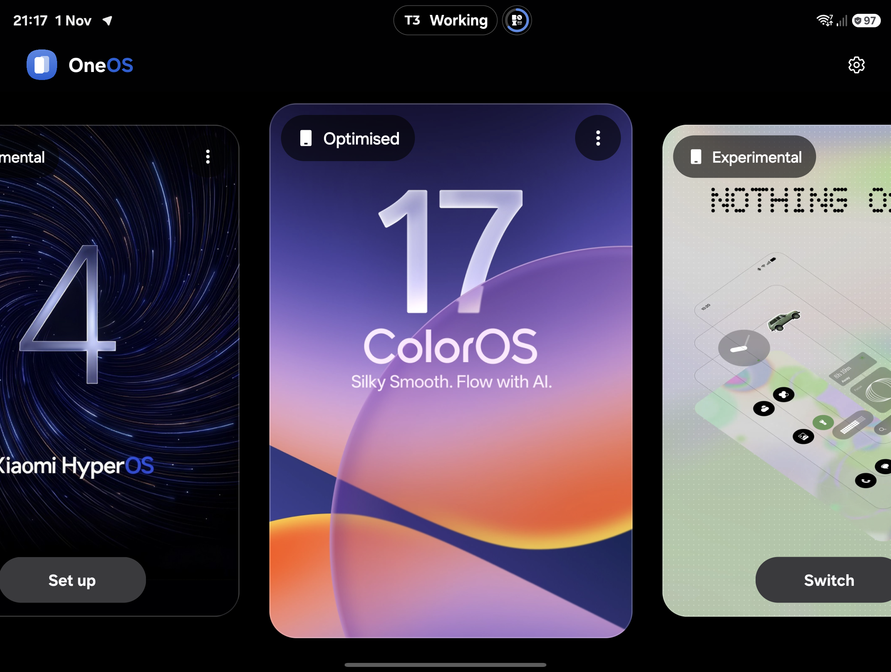
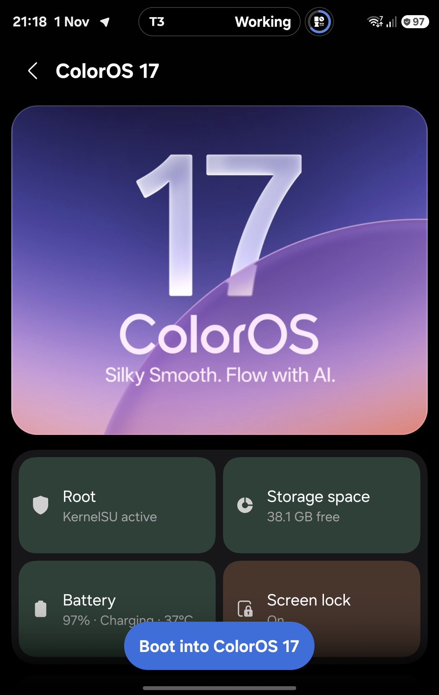
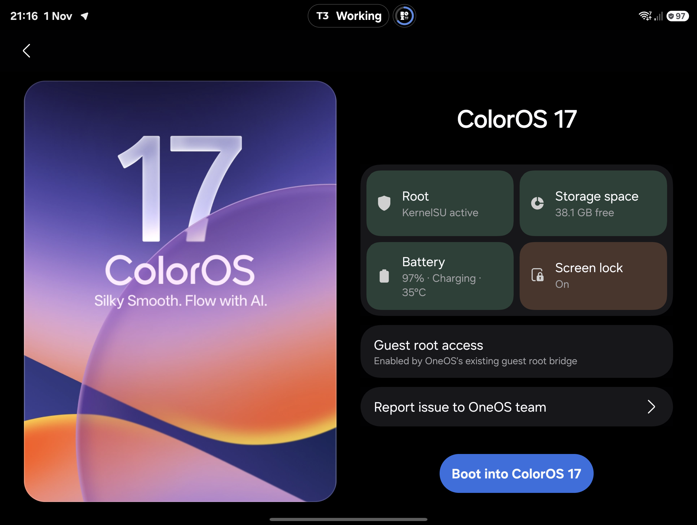
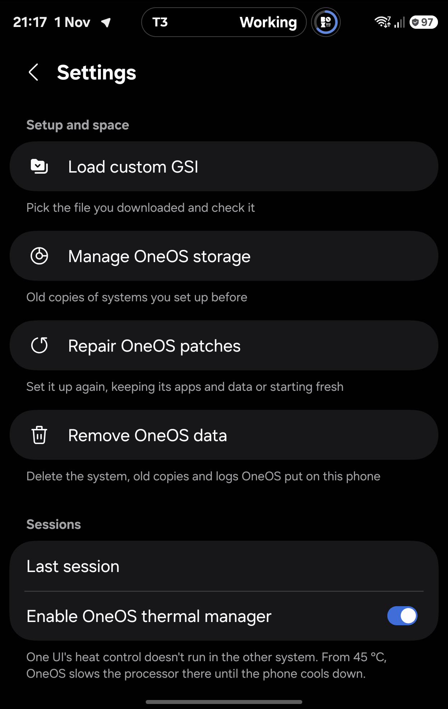
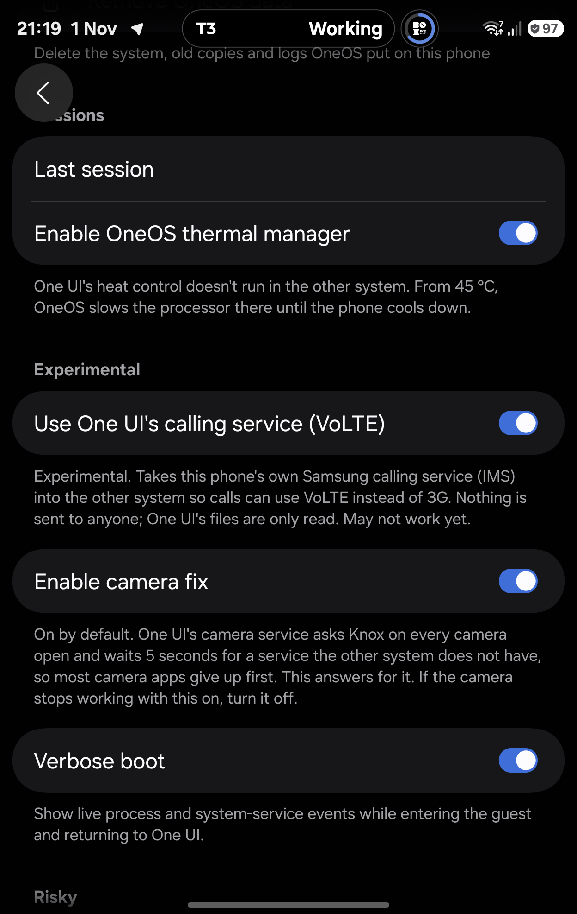

# OneOS interface: cover and inner screens

Captured from the physical Galaxy Z Fold8 (SM-F971B), running the accepted
OneOS 0.4.38 debug build on One UI. These are actual app captures, not Figma
mockups. The captures precede the upstream 0.4.37 merge; the UI source is
unchanged by that merge. No OS switch or update was started for photography.

## New icon and wordmark

The launcher uses separate adaptive foreground/background layers. The picker
header combines the icon with the OneOS name and blue OS accent.

## OS picker

| Cover screen | Inner screen |
| --- | --- |
|  |  |

The last selected OS starts centred in the picker. Card scale follows scroll
position, selection gives a haptic tick, and the layout adapts when folding.

## Pre-boot checks

| Cover screen | Inner screen |
| --- | --- |
|  |  |

Root, storage, battery and screen-lock facts use state tints. The Boot/Update
action stays fixed on mobile; scrolling content fades behind it. A pending
check shows a native spinner and cannot authorize boot. Artwork transitions
connect the picker, setup/update, checks and boot pages.

## Settings and verbose boot

| Settings | Experimental options |
| --- | --- |
|  |  |

Verbose mode reports observed process events and requested service operations
on entry and return. The return frame remains static while no compositor
runs, then live status resumes with One UI's compositor. The owner confirmed
entry and return working on the Fold8. See [boot status](../boot-status.md)
for implementation and guest release-signing requirements.
