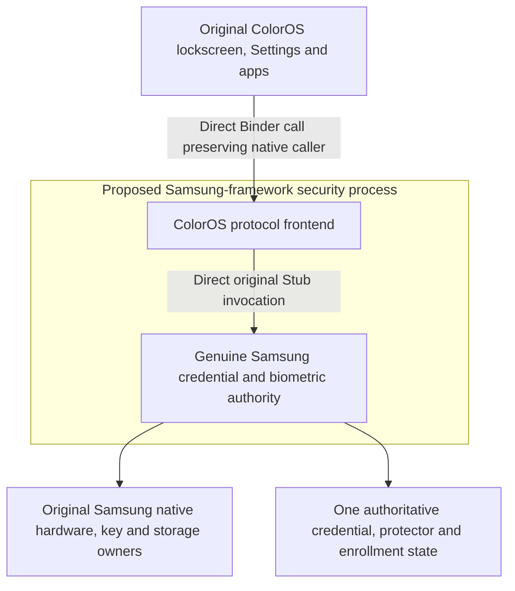

# Architecture review: choose the authority placement before expanding adapters

November 5, 2026. This reviews the complete [goal](GOAL.md): genuine ColorOS
under OneOS with reciprocal PIN and fingerprint management, real Samsung policy,
authentication-bound app keys, encrypted storage and safe switch/return behavior.
It does not substitute a cosmetic lockscreen or a smaller end requirement.

## Decision

The current guest-process import has **not** been established as the best method.
Make a dedicated Samsung-framework security process the first architecture to
test against that import. Keep the guest-process import as a fallback. Stop
expanding general compatibility leaves until this placement decision has a
concrete bootstrap and ownership answer.

This selects the next investigation priority, not a working runtime. Two Sol
reviewers exchanged critiques of the current approach and alternatives. Neither
source inspection nor their agreement establishes that either process can safely
construct the required authority. A separate process must earn that conclusion.

## Current gate after staged-code identification

The initial cold-process preference has not earned runtime selection. The
subsequent [Samsung production-factory review](docs/samsung-user-registry-owner.md)
and [user lifecycle review](docs/samsung-user-registry-lifecycle.md) show that a
Context/handler and UMI state forwarding do not supply actual PMS/Persona,
UserDataPreparer, package reconciliation or Samsung storage-prepared ownership.
No further cold security-graph leaf is selected to hide those missing owners.
This does not prove that the entire SystemServer is mandatory.

The [installed OneOS code profile](docs/installed-oneos-code-profile.md) now binds
the0.4.57/code74 APK, exact staged image/set manifests and three acquired patched
JARs. Original donor proofs remain conditional until the corresponding staged
bodies are compared. Neither a source patcher nor the staged manifests alone
establishes the loaded runtime or native service ownership.

The next discriminating implementation is a bounded, initialized-only capture
of the genuine existing Samsung user/package/storage cohort, followed by the
actual guest lifecycle and native data-view routing contract. Capture must
retain the original instances and verify their real publication/parent links;
it must not create a registry, realize a provider or turn a boot-phase Boolean
into native/security readiness. Retaining a process remains an investigation
until all six live-topology gates in the retention comparison close.

The host Context diagnostic is prepared for the cold-process comparison. It is
secondary to this owner decision and does not by itself qualify a retained or
cold security authority. Runtime placement and all18 device cases remain open.

The November 8 read-only refresh identifies the installed OneOS as **0.4.59,
code 85**, with a matching 49-row current stage manifest. Its actual shipped
switch still stops and rebuilds the original Samsung framework. The newer
watchdog, composer and resource-cache handling does not provide continuous
Samsung owner lifetime or acknowledged physical display withdrawal. The two
main staged JAR hashes still match the historical source evidence, while the
current Oplus services JAR and several selectors changed. Use the [code 85
baseline](docs/installed-oneos-code-profile.md#current-0459--code-85-baseline)
for new admission evidence.

## Proposed process boundary

The protocol frontend and original backend must share the same process. A
privileged guest-side forwarder calling a remote Samsung service would change
the kernel caller and is a different, unproved design. The existing authored
direct-dispatch transport is reusable in this proposed placement; it does not
require the backend to live inside ColorOS's system_server.

A promising naming arrangement preserves `lock_settings` as the genuine Samsung
protocol and publishes the ColorOS frontend under an explicit separate alias.
Every admitted ColorOS lookup must be retargeted to that alias. This avoids
Samsung framework clients accidentally speaking Samsung transaction numbers to
the guest protocol. Never select overlapping protocols by package, UID1000 or
their shared descriptor. Publication, all real lookup consumers, caller policy,
death and return still require exact closure.

## Why challenge the current placement

The existing guest-process plan crosses two incompatible framework realms.
Source checks have exposed private/canonical Parcelable differences, missing
Samsung framework members, LocalServices Class-key identity, per-instance
LockPatternUtils service routing, native registration and DEX041 loader/subset
requirements. These are substantive construction obligations, not just a few
method numbers to translate.

A process using the original Samsung framework could avoid many of those
cross-loader collisions and use its original native registration environment.
That is an engineering inference. It does not give the new process the old
system_server's initialized objects. It still needs genuine Context/resources,
users/serials, policy, local services, storage, biometric owners and boot phases.
Existing native daemons are not replacements for those Java authorities.

| Method | Decision for this goal | Main unresolved work |
| --- | --- | --- |
| Dedicated Samsung-framework process, with frontend and backend together | Test first | Real authority bootstrap, explicit endpoints, physical state ownership and exclusive handoff. |
| Private Samsung service/framework import into ColorOS | Keep as fallback | The same real owners plus private/canonical linking, resources, native and loader adaptation. |
| Keep the entire existing One UI system_server alive | Do not treat as a small switch | Two live framework service namespaces, native/display ownership and OneOS lifecycle/return separation. |
| Graft only SPM or rewrite security against native HALs | Do not choose merely because it looks smaller | The rest of Samsung policy, StrongAuth, mutation/recovery, key and storage semantics remain required. |
| Original ColorOS UI over a live One UI runtime | Different delivery route requiring a full UI proof | Stronger existing backend continuity, but a large UI port and a change from the current whole-guest route. |
| Upgrade OneOS or remove its preservation guards | Not an implementation of the missing authority | Current upstream still stops the host framework and blocks guest changes to shared security state. |

## Finite gate before further expansion

Compare the dedicated-process and guest-process candidates against the same
four obligations. Produce actual selected owners and original callsites; an
opaque admission callback, class name, copied snapshot or default value is not
an answer.

1. **Bootstrap:** pin the real runtime/classpath/native/resource environment and
   the actual Context, user, policy and local-service dependencies required before
   active Samsung constructors. Identify every constructor/phase that can start
   work or mutate state. Do not start the whole Samsung framework just to hide a
   missing dependency. Current OneOS also kills generic `app_process64`; an
   authority launched before that step cannot be assumed to survive. Select an
   explicit launch window and preserve the intended mount/code view.
2. **One state owner:** bind the original physical users/serials, credential/
   protector/slot and enrollment views, native endpoints and key namespaces.
   Define exclusive ownership from One UI quiescence through ColorOS use to
   acknowledged service/callback/native drain before return. Never rely on a
   duplicate database or presumed hardware rollback.
3. **Direct endpoints:** close original Samsung and guest protocol publication,
   every selected lookup, actual native caller, typed user/purpose enforcement
   and backend-death behavior. Keep the frontend and original backend together;
   no privileged identity substitution or protocol guessing.
4. **Discriminating acceptance:** first prove the process and non-authentication
   boundary under a concrete reviewed artifact. Only after real ownership closes,
   prepare separately approved genuine credential/crypto/CE tests. Verification
   itself can mutate real state; it must not be presented as an inert read-only
   check. Original LSS/SPM/fingerprint construction can also mutate state before
   authentication and requires pre-construction admission. Full reciprocal
   PIN/fingerprint and recovery acceptance still follow.

Prefer the dedicated process if it removes the demonstrated class/native/type
collisions without recreating a second full system_server/service graph or
replacement policy engine. A separate Samsung framework/VM realm beside the
ColorOS runtime is part of this proposal and carries its own unmeasured cost.
Reject it as the preferred placement if its real owners cannot be supplied, it
requires recreating substantially the whole system_server, or handoff/caller/
state ownership becomes less tractable. Evaluate the guest-process fallback
against that concrete result, not against a hypothetical effortless broker.

## Current upstream and reusable work

Fresh official upstream inspection found OneOS **v0.4.57**, commit
`1f2c2aa45ab8a7dc81384f6b67962d1e9cf7fefe`. The inspected Gatekeeper, Weaver,
vold-key and biometric-cleanup guards are byte-identical to the prior 0.4.55
snapshot. Current switching still stops host zygote/system_server. The inspected
switch/prepare changes concern watchdog and display behavior. No upgrade-only
shared-security implementation was found in those exact sources. See the
[pinned upstream comparison](inventory/method-review-upstream.json),
[current switch source](https://github.com/fahadalijaved/OneOS/blob/1f2c2aa45ab8a7dc81384f6b67962d1e9cf7fefe/switcher/assets/oneos_switch.sh)
and [credential guard](https://github.com/fahadalijaved/OneOS/blob/1f2c2aa45ab8a7dc81384f6b67962d1e9cf7fefe/switcher/patches/guest_no_gatekeeper.py).

The current app does allow an explicit Advanced override to launch with a screen
lock set; unknown lock state still blocks. That launch choice does not implement
shared PIN/fingerprint authentication. The actual overlay producer still applies
the inspected preservation guards. The input ledger pins those three supplemental
producer/app files as well as the initial eleven-source snapshot.

The reviewed credential protocol/transport, optional ColorOS removals and exact
state/native evidence remain useful whichever placement wins. The private SID
binding and some loader work may be unnecessary in an original Samsung runtime;
do not force their use to justify work already completed.

Matching a PIN alone is insufficient. Authentication tokens, secure user IDs
and intended key ownership matter to real app-key use, as described by
[AOSP Gatekeeper](https://source.android.com/docs/security/features/authentication/gatekeeper)
and [Keystore](https://source.android.com/docs/security/features/keystore).
Those platform descriptions do not establish this Samsung integration's behavior.

All 18 device cases, runtime selection, PR readiness and beta readiness remain
open. No phone change, guard removal, service activation, root automation,
restart or remote publication was performed for this review.
