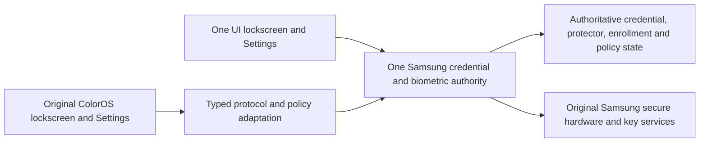

# Shared Samsung security for One UI and ColorOS

Planning date: November 5, 2026. Owner: Apple.

[GOAL.md](GOAL.md) records the agreed first-device, upstream PR and beta-release
scope. Its later delivery decisions govern the release gates below; the full
bidirectional functional requirements remain unchanged.

## Required finished behavior

One UI and genuine ColorOS use one Samsung-controlled credential, fingerprint
and security-policy state. A completed change made through either OS is the
authoritative change used by the other when it starts. There is no separate PIN
to configure, delayed password replication or guest-only enrollment database.

The required user stories are:

1. Set a PIN in One UI; enter ColorOS and unlock with that PIN.
2. Change the PIN in One UI; the new PIN unlocks both systems.
3. Change the PIN in native ColorOS Settings; return to One UI and unlock with
   the new PIN. Earlier PINs fail ordinary unlock in both systems.
4. From a genuinely credential-free baseline, create the PIN in ColorOS; it
   becomes the PIN accepted by One UI too. This is a separate controlled test.
5. Existing fingerprints work in both systems, subject to real PIN/StrongAuth
   requirements. Enrollment, removal and supported management changes made in
   either OS are reflected in the other.
6. Native lockscreen, Settings, credential confirmation and app authentication
   consume the same real authority. Protected storage and authentication-bound
   keys continue to follow their actual policies across changes and switches.

Successful credential changes may legitimately rotate protectors and update
hardware state. Fingerprint changes may legitimately invalidate keys configured
for that behavior. Harmony means consistent correct policy, not freezing every
identifier, accepting an old PIN indefinitely or keeping every key valid against
its declared policy. Samsung's explicit previous-credential recovery, if enabled,
must remain distinct from ordinary unlock and have an explicit compatibility
decision; it cannot silently become an old-PIN unlock fallback.

PIN and fingerprint are the primary delivery requirements. The security-surface
inventory must also account for password/pattern choices, credential removal,
profiles/admin policy, remote lock, recovery and security functions exposed by
the selected image. Unresolved exposed paths block an unqualified full-security
claim. Other OEM features such as face authentication or Samsung-specific
services need explicit coverage status; support is not inferred from PIN success.

## Architecture contract

Apple's latest direction prefers changing ColorOS consumers/framework glue to
use Samsung's real APIs. Optional unsupported OPPO-only features may be removed,
with their UI, registrations and background/callback work safely closed. Track
the removed feature and exact boundary. The required reciprocal credential,
fingerprint, policy, app/key and encrypted-data outcomes remain intact.

The mandatory model is **one logical Samsung authority and one current writer**.
The exact process arrangement still needs proof. Investigate the existing
candidate: an exact guest-compatible interface over a coherent imported Samsung
security service family. Compare a retained authority only where the actual
construction/handoff evidence justifies it.

This is an implementation contract, not a running architecture. The authority
may be retained across runtime switches or transferred between strictly exclusive
genuine Samsung service instances. Either design must use the correct original
state and native owners, preserve caller/user/challenge identity, and reconcile
pending operations before ownership changes. The standard OneOS switch kills
host system_server; a retained Java authority does not survive by default.

Each OS can retain its own app/data layout. Sharing authentication requires
explicit correct CE-storage, app-UID/key-namespace and user ownership for both;
merging app databases or exposing the whole host data tree is not the design.
Plaintext PINs, synthetic passwords, HATs and private keys must not enter logs,
PC artifacts or a background synchronization store.

## Delivery sequence

All rows below are future implementation/acceptance gates unless explicitly
marked as source evidence. No device gate is accepted today.

| Stage | Result to produce | Required acceptance before advancing |
| --- | --- | --- |
| 0. Pin the actual target | Exact host build, selected OneOS image/patched bytes, user/profile and native-service identities; security surface and recovery baselines | Distinguish captured original firmware, OneOS producer intent and installed patched code. Record missing live facts. Read-only discovery must not invoke active HAL/credential initialization. |
| 1. Close the authority and handoff design | Version-pinned construction, dispatch, state/resource/storage and lifecycle plan with one writer | Every required real owner is identified; no guessed constructor, missing binding, permissive policy default or second writer. Source-defined verification/startup writes and uncertain progress already have an ownership/recovery contract. This is the current critical path. |
| 2. Build a default-off systemless candidate | Original Samsung service payload plus exact transport, resource, policy and original ColorOS integration; bounded diagnostics and disable/return mechanism | Offline build/link/DEX/resource/provenance and authored failure checks pass. Prepare exact artifact hash, touched paths/hooks, startup/recovery sequence and device test. Real Android/crypto behavior remains unproved. Installation/activation needs separate approval. |
| 3. Prove the existing PIN | Genuine ColorOS keypad verifies the existing One UI PIN and preserves host authentication | Correct PIN works; wrong PIN, cancellation, lockout, StrongAuth and extra-factor behavior are genuine. Observe full result/policy and protected-key/storage effects. Return to One UI with the same credential/data intact. This is the first visible security milestone. |
| 4. Prove existing fingerprints | Genuine ColorOS fingerprint and app-authentication paths use an existing Samsung enrollment | Correct fingerprint works in each OS after required primary authentication; wrong/removed/unmapped requests fail. Complete the same fresh native authentication-bound key operation, not just a callback. Cancellation/session drain and host return pass. |
| 5. Enable the complete PIN lifecycle | Set/create/change/remove through native Settings under the one authority | Run initial creation in each OS on separate baselines, both change directions and the roundtrip below. Old PINs fail normal unlock; current PIN, expected fingerprints, CE access and applicable app keys remain correct. Credential removal follows real policy and is tested separately with approval. |
| 6. Enable fingerprint management in both | Shared enrollment/list/rename or supported metadata/delete-one/delete-all and enabled-use policy | Add in either OS, use in both; remove in either, reject in both. Preserve unrelated enrollments on remove-one, real authenticator-ID/key invalidation rules and post-PIN-change primary-auth requirements. Interrupted enrollment/removal reconciles before success. |
| 7. Harden and accept full compatibility | Bidirectional lifecycle, app authentication, feature admission/ownership, recovery, persistence and performance; upstream handoff and beta evidence | Apply GOAL.md's distinct PR-ready and beta-release-ready gates. Required normal-flow results, controlled upstream failure campaign, supported security-surface matrix, feature checks, repeated switches and user-controlled cold-boot continuity pass before beta readiness. App/key/storage results and measured latency/idle behavior meet agreed budgets. Disclose inherited platform limits; Apple accepts normal use and maintainers control rollout. |

Existing-PIN and existing-fingerprint milestones are intermediate proofs. They
do not remove either direction of credential/enrollment changes from the goal.
No reliable completion date is established until stages 0-2 prove the real
construction and ownership boundary; estimates should be revised at each actual
device gate rather than derived from static method/test counts.

## Immediate engineering order and parallel work

Reuse the completed source audits and exact readers; do not repeat broad OS pulls
or full decompilation. Eight scoped workers can progress in parallel, with root
owning shared decisions and integration:

| Stream | Next concrete deliverable | Prerequisite/dependency |
| --- | --- | --- |
| Authority/startup | Exact guest startup replacement site, real Samsung factories/boot phases, canonical/private types and local services | Source pins plus concrete Context/UserManager/storage/native bindings; whole-framework versus retained-authority choice remains evidence-driven |
| State/storage/keys | Original state and CE/key namespace bindings, exclusive handoff, permitted migration/write protocol and recovery checkpoints | Must precede active construction, verification or credential mutations |
| Protocol/trust/resources | Full reached caller surface, typed Binder/parcel translation, effective resource policy and enforced caller/user/operation admission | Known examples include checkCredential10 versus54 and incompatible resource meanings; no opaque forwarding or hard-coded base policies |
| ColorOS frontend | Native keypad/Settings/confirmation/enrollment contracts, applied policy readiness, cache invalidation and RPMB consumer plan | Real selected authority/user state before callbacks can authorize completion |
| PIN lifecycle | Exact create/change/remove and previous-credential recovery paths, durable outcome/readback and post-change notifications | Verification itself can migrate state; initial credential ownership is mandatory |
| Fingerprint lifecycle | Existing-provider reuse, sensor/enrollment/session mapping, token consumption, then add/remove and metadata updates | Original enrollment state before provider acquisition/cleanup; genuine primary-auth and challenge authorization |
| Build/integration | Immutable packaging, compatibility admission, diagnostics, default-off controls and prepared device-review artifacts | Complete selected dependency graph; no null/empty/success placeholders |
| Independent verification | Cross-report/source review, required negative cases and actual runtime acceptance | No authored model, compiled payload, matching wire format or success callback substitutes for device security |

Implementation should cache verified metadata outside event/frame paths, bound
requests and callback lifetimes, and avoid polling, resource creation or bytecode
verification per authentication event. Set numerical startup/authentication/idle
budgets from real baselines before claiming responsiveness or battery parity.

## Mutation and switching protocol to prove

1. Admit the real caller, selected user/profile, operation and current authority
   generation. Confirm genuine previous-credential/setup/enrollment authorization
   and current policy. A cached unlocked flag is insufficient.
2. Serialize against all competing credential, fingerprint and source-defined
   maintenance writes. Account for One UI's ordinary stock flows as well as
   imported ColorOS flows; both must participate in state ownership/handoff.
3. Execute Samsung's source-supported transaction and preserve its actual commit
   ordering, permitted reenrollment/protector changes and key/storage effects.
   There is no assumed atomic transaction spanning filesystem, Weaver, Gatekeeper,
   KeyMint and vold, and no assumed ability to roll hardware state back.
4. Retain bounded non-secret operation/phase/generation evidence for recovery.
   Resolve actual authoritative completion before reporting a successful change.
   Timeout or lost reply can mean an uncertain commit; do not blindly retry.
5. Publish the new authoritative state, invalidate stale presentation/policy
   caches and reject old callbacks/handles as their real contracts require.
   The next runtime reads that committed state before enabling authentication.
6. Before switch/return, quiesce ingress, drain/cancel actual sessions and work,
   reconcile incomplete changes and transfer exclusive ownership. If outcome or
   ownership is uncertain, prevent conflicting writers and remain fail-closed
   under the reviewed recovery path. Never restore an old database to make a
   previous PIN work again.

Disabling the module must not turn a protected ColorOS session into an unlocked
swipe screen. A safe return must retain the latest committed credential and
native state. Code rollback and credential rollback are different operations.

## Required cross-OS acceptance matrix

`P_A`, `P_B` and `P_C` are test labels, never actual PINs in logs or artifacts.
Every case records exact versions, approved actions, non-secret result evidence,
source/authority identity and expected legitimate state changes. All are pending.

| ID | Action | Required result |
| --- | --- | --- |
| PIN-01 | From a verified NONE baseline, set P_A in One UI | P_A unlocks both OSes; ColorOS recognizes the existing authoritative credential |
| PIN-02 | On a separate verified NONE baseline, set P_A in ColorOS | P_A unlocks both OSes after return; no second credential setup is needed |
| PIN-03 | Change P_A to P_B in One UI | P_B works in both; P_A fails ordinary unlock in both |
| PIN-04 | Change P_B to P_C in ColorOS | P_C works in both after return; P_A/P_B fail ordinary unlock in both |
| PIN-05 | Repeat One UI to ColorOS to One UI changes and switches | Every successful change is immediately authoritative on next entry; no stale cache or delayed reconciliation |
| PIN-06 | Wrong current/old PIN, lockout, cancellation, lockdown and additional factor | Both frontends enforce the same actual policy; no false readiness/default or stale success |
| PIN-07 | Credential removal or exposed password/pattern/recovery flow | Real supported policy and both-OS state match; special prior-PIN recovery never counts as ordinary unlock |
| FP-01 | Existing Samsung fingerprint in each OS | Genuine unlock/app authentication after required current-PIN/StrongAuth; no re-enrollment just to switch |
| FP-02 | Enroll a fingerprint in One UI | It appears and authenticates in ColorOS and One UI |
| FP-03 | Enroll a fingerprint in ColorOS | It appears and authenticates in One UI and ColorOS |
| FP-04 | Remove one, then separately remove all, initiated from each OS | Removed prints fail both; unrelated prints survive remove-one; lists and real authenticator generations agree |
| FP-05 | Change PIN in either OS with enrolled fingerprints | Supported enrollment continuity and required primary reauthentication work; no unsolicited cleanup or forced enrollment reset |
| APP-01 | Native credential confirmation, BiometricPrompt/CryptoObject and fallback in both OSes | Correct caller/key/challenge/confirmation policy; the exact fresh native operation completes only with genuine authorization |
| DATA-01 | Existing CE data and applicable app keys before/after each operation | Continued intended access; intentional policy-defined invalidation is distinguished from corruption or wrong identity |
| FAIL-01 | Interrupt at actual mutation, cleanup, callback and handoff boundaries | Known resolved outcome or explicit uncertain recovery; no double writer, blind retry, false success or stale restore |
| RETURN-01 | Repeated switch/return, screen lock, runtime/service death and HAL reconnect | Current credential/enrollments/policy remain coherent; secure access and recovery are preserved |
| BOOT-01 | Later user-performed, explicitly agreed cold boot and manual root restoration | Current PIN opens intended data/keys; biometrics follow real first-unlock policy; both runtimes work after authorized root restoration |
| RELEASE-01 | Supported security surfaces, feature admission/ownership, documented platform-isolation limits, update mismatch and measured normal use | No unresolved required path or silent bypass; wrong versions fail admission safely; required normal and controlled-fault evidence passes; Apple accepts normal use and maintainers own release acceptance |

Fresh app-key proof must verify actual per-use key authorization and a real native
operation challenge. A random framework operation ID, warm already-unlocked CE
storage or fingerprint callback does not prove it. Failed attempts and lifecycle
interruptions are active security operations and require a bounded approved test.

Apple chose separately approved normal-flow tests on the current phone. Controlled
upstream devices must supply deliberate mutation/interruption/recovery testing;
no such participation is presumed. Pending upstream fault and cold-boot evidence
may be listed in a PR-ready handoff but blocks beta-release readiness. See
[GOAL.md](GOAL.md#5-pr-ready-contribution-versus-beta-release-ready-feature).

## Integration, permissions and stopping rules

Plan and PC implementation are not phone installation/activation permission.
Prepare concrete artifacts and recovery first. Existing OneOS-owned phone app,
data and stages remain untouched by this planning work; select a separately owned
systemless integration/test layout. If a candidate needs an exception to the
existing OneOS-owned-data rule, document the exact requirement for explicit
approval rather than treating it as granted. Enabling OneOS's existing risky
screen-lock override is not the compatibility implementation or acceptance.

Agent-initiated reboot, flashing/raw partition writes and root-exploit automation
remain prohibited. Cold-boot continuity is a later user-controlled acceptance
gate, including temporary-root behavior; this plan does not authorize a reboot.

Pause activation/mutations on mismatched inputs, unresolved state identity,
unexpected template/protector changes, uncertain commits, unexpected key/data
loss, incorrect caller admission or bypassed policy. Preserve the real owners and
last authoritative state; do not force an unlock or wipe/reset to pass a test.

The chosen delivery scope supports shared Samsung security with documented
existing OneOS SELinux Permissive and relaxed privileged-permission limitations.
Restoring stock-equivalent global platform isolation is not a prerequisite.
Feature entry points must still enforce real caller/user/operation/challenge
and current-authority checks and preserve genuine Samsung policy. Unknown
authorization fails closed. Compatibility does not prove protection against
privileged/root compromise or isolation between shared system UIDs. Required
functional and recovery failures cannot be excused as platform limitations.

## Evidence and present state

The first static investigation is committed at `2785a87`. Existing detailed
reports remain unchanged and are linked from [the candidate architecture](docs/architecture.md).
Eight scoped planning reviews cover credential lifecycle, fingerprints, state/
recovery, runtime handoff, trust, ColorOS UX, build gates and the acceptance matrix.
Their original exact-byte review is historical at local commit `9974488`;
the later GOAL.md review records the delivery-scope update separately.

This plan is complete as a planning artifact. Construction/implementation and
all device gates remain incomplete. The original ColorGlass bridge goal stays
paused; this nested security project preserves the full bidirectional outcome.
