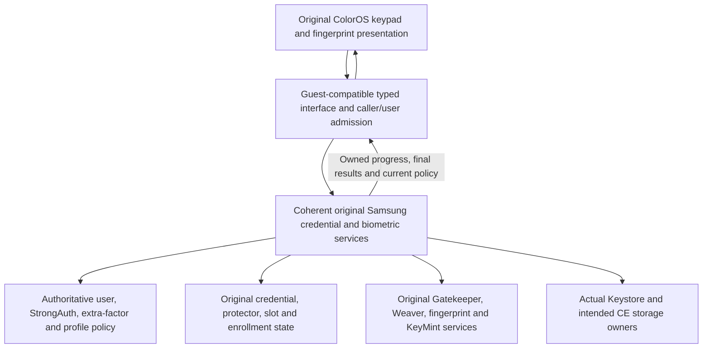

# Samsung-controlled security inside ColorOS: first candidate boundary

Status: source-supported investigation candidate, **not a runnable transplant**.
No OEM implementation, authentication operation or phone action has run. The
original ColorGlass project remains paused. End requirements in TASKS.md remain
unaccepted.

## First offline candidate

Investigate a guest-compatible security interface backed by a coherent imported
Samsung service family. Retain genuine ColorOS presentation and the original
Samsung credential/protector, policy, enrollment and native-key authorities.
This is the first candidate to close against actual source, not a decision that
a tiny adapter or a full Samsung framework is sufficient.

Every box has unresolved construction or runtime obligations. An edge is an
observed required contract or proposed ownership boundary, not an implemented
capability. Shared app UID, numeric user 0 and service names are insufficient
identity proofs.

## What the source now settles

| Finding | Consequence for an actual import |
| --- | --- |
| Original ColorOS input reaches `ILockSettings.checkCredential` and consumes real progress plus full `VerifyCredentialResponse`. | Keep the genuine input/controller chain. Supply exact policy/user/result contracts rather than replace the visual frontend. |
| ColorOS credential-check transaction is 10; Samsung is 54. Samsung case 10 is carrier-lock configuration and checks trailing parcel data before invoking it. | Raw Binder forwarding is incompatible. Use exact typed dispatch/translation. Do not describe the mismatch as proof that a normal forwarded credential parcel actually changes carrier state. |
| Selected credential, response and progress-callback parcel fields align. Fingerprint has selected matching request/callback codes but a same-width field changes meaning: duplicated-image count versus OPPO finger flags. | Admit only source-reviewed operations and explicit conversions. Matching widths, descriptors or service names do not establish whole-interface semantics. |
| Samsung credential verification can reenroll handles, upgrade blobs and create security-integrity Weaver state. Weaver initialization can refresh/write slot mappings. | One authoritative existing state owner must serialize permitted source-defined changes and handle incomplete progress. An always-read-only verifier or blanket removal of OneOS guards would change behavior. Hardware rollback is not presumed possible. |
| Fingerprint provider acquisition can schedule cleanup and authenticator-ID work. | Constructing a service or obtaining its HAL is active work. Establish enrollment/user/session ownership before initialization. |
| Both systems contain early credential-progress semantics. | Treat progress, final cryptographic result and full policy state as separate. This is not evidence of a newly discovered timing vulnerability or a Samsung-only incompatibility. |
| Original ColorOS has a secure-lock-device/additional-factor dismissal gate. Samsung also has an awaiting-additional-factor path. | Preserve real state feeding that gate; a primary match cannot stand in for completed policy. The exact cross-service state connection needs closure. |
| Samsung classes read framework resource IDs with different meanings in ColorOS. Same-named base policy values can also differ. | Supply an owned, policy-correct resource environment. A global guest Context or numeric-ID remap alone is insufficient. Effective overlays/runtime values remain unverified. |
| LockSettings construction starts threads, registers receivers, builds storage and publishes local state. Its original code expects concrete Samsung storage/local-service types. | Resolve the real lifecycle, local registry, resource and storage contracts before construction. A constructor probe is not passive, and same-name classes in separate loaders are different identities. |
| OneOS stops host system_server and uses guest-derived classpaths. | Existing Samsung Java services do not survive by assumption. A retained-process alternative would require deliberate lifecycle and return changes; native services and Java authority are separate. |
| A genuine fingerprint success callback can follow token-deposit failure; an operation ID can be a random framework fallback. | Runtime acceptance needs the actual native challenge/key policy and completion of the same fresh authentication-bound cryptographic operation. UI success or nonzero IDs are insufficient. |

These are bounded facts. See [credentials](credentials.md),
[fingerprint](fingerprint.md), [storage/keys](storage-keys.md),
[startup/import](startup-import.md), [trust/policy](trust-policy.md),
[ColorOS frontend](coloros-frontend.md), [resource compatibility](resource-compat.md),
[additional-factor gating](strong-auth-gating.md), and
[independent review](independent-review.md).

## Required construction and ownership cut

1. **Explicit guest entry.** Declare every required frontend/framework caller,
   exact transaction, argument/reply semantics and callback owner. Preserve the
   original caller UID/user/purpose before identity clearing or thread hops;
   crossing as privileged UID 1000 must not grant new authority.
2. **One Samsung Java authority.** Select actual LockSettings/SyntheticPassword,
   StrongAuth/rate-limiter and biometric owners, their factories and lifecycle.
   Preserve the real constructor/boot phases and required conditional Knox/DAR
   policy. Do not fabricate missing constructors or force features off.
3. **Canonical/private type plan.** Keep framework Binder/Parcel and public Java
   identities coherent. Resolve service-class collisions and concrete
   LocalServices/storage dependencies deliberately. A private-loader label does
   not close those edges, and importing the entire services JAR is not a plan.
4. **Authoritative state and resource plan.** Resolve the original selected user,
   credential database, SP protector records, Weaver slot map, enrollments,
   resource policy and native key namespaces to one retained owner. The mounted
   OS dump excludes live user security metadata; no private credential state was
   collected or copied in this investigation. A guest-empty data tree is invalid.
5. **Exact native and storage routes.** Preserve original Gatekeeper/Weaver/
   KeyMint/Keystore/fingerprint owners and intended host/guest storage identities.
   Account for the actual Samsung IVold signatures, HSUM/profile behavior,
   existing UID/key domains, HAL sessions and cancellation. Declared manifests
   do not prove the running owner or hardware acceptance.
6. **Policy and completion.** Connect genuine StrongAuth/additional-factor/user
   state to the original ColorOS gates. Preserve authenticated progress and final
   response identities, opaque HAT/handle semantics, OEM RPMB consumers and
   cancellation/death/return handling. Do not mint success, clear policy or assume
   hardware enrollment can be rolled back.

OneOS's existing preservation guards remain intact outside any future explicitly
reviewed replacement boundary. Their producer intent is separate from the
unpatched supplied ColorOS jars and the unknown current installed patched bytes.
Global SELinux Permissive mode is an additional trust-boundary gap, not resolved
by implementing a PIN interface.

## Next meaningful proof

The next implementation proposal should be a version-pinned **construction and
dispatch plan**, not an installation. It must enumerate selected original
classes/factories, canonical/private type choices, real resource/local-service/
storage bindings and every changed startup/dispatch edge. Unknown entries remain
blockers rather than successful empty providers. Compare this import candidate
against a retained-authority design only at actual unresolved ownership cuts.

Only after that plan is coherent should a bounded test artifact be prepared for
review. A device test needs separate approval and must demonstrate genuine
credential policy, existing-enrollment fingerprint, fresh auth-bound crypto,
correct CE/key ownership and host return. Credential changes/synchronization and
user-performed cold-boot continuity remain explicit later acceptance gates. No
reboot or modifying phone test is authorized or requested here.

Current evidence has not established a fundamental impossibility, an executable
minimal service closure, a safe live-state mount/authority arrangement or a finish
date. Static audits narrow those questions; they do not answer them by execution.
