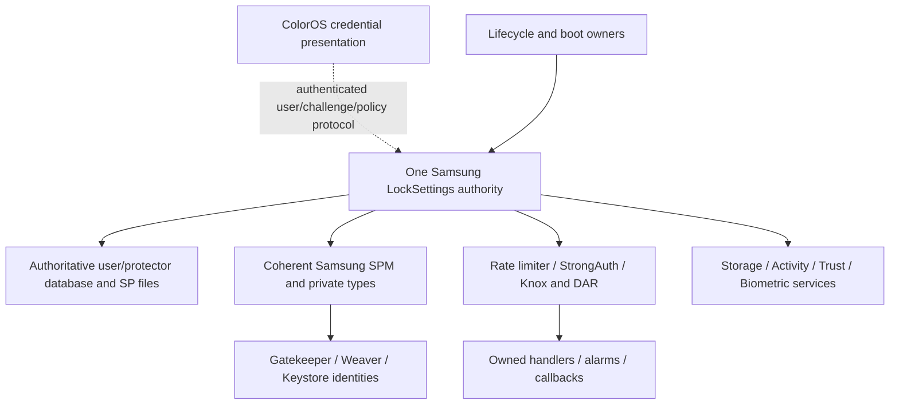

# Credential authority: actual Samsung source boundary

**Observed source, 2026-11-05:** the supplied Samsung verifier is part of a stateful credential authority. Successful PIN/password verification can reenroll Gatekeeper records, upgrade synthetic-password blobs and allocate a security-integrity Weaver slot. A verifier that categorically forbids enrollment or storage writes does not preserve all of this implementation's semantics. A single authoritative transaction owner is a candidate requirement; neither a working transplant nor a broker has been demonstrated.

This is an offline, bounded body audit. No OEM class, service, JNI implementation or authentication request ran. There is no verified runtime behavior in this report. Existing OneOS guards remain necessary until an owned replacement is demonstrated.

## Reproducible evidence

[inventory/credentials.json](../inventory/credentials.json) pins archive identities, normalized method bodies, raw/reader receipts, 13 checked source-edge groups, a candidate graph and 556 direct invocation edges to the selected methods within the corresponding archive. Its `pass` means evidence assertions passed. It does not mean security integration passed. [tools/audit_credentials.py](../tools/audit_credentials.py) regenerates the inventory with `--report` from the pinned receipts and immutable parent indexes.

The shared DEX041-aware reader scanned the full physical Samsung `classes.dex` container: 18,916 classes across logical headers 0 and 10,057,984. Selected Samsung credential owners reside in the latter header. The Samsung services archive SHA256 is `def967fbcb9498d530614b31b9c535540cb24ca5e6f20caf95f874bbe29639f6`; the original ColorOS archive is `66d0d51daf3a0796d8c14e76db134101e9523d91233dfce79df71e775931edf3`. There are 80 selected Samsung methods, including one native declaration without a body, and 66 selected ColorOS code bodies. This is not a full-JAR decompilation or transitive closure. Earlier provisional text dumps are superseded by the shared-reader JSONL proofs.

Below, `LSS` means `com.android.server.locksettings.LockSettingsService`; `SPM` means its same-package `SyntheticPasswordManager`. PCs are hexadecimal DEX code-unit offsets within the exact named body. Inventory method keys include complete descriptors; each supplies the body hash, logical header, raw path and reader receipt. These are more precise than decompiler line numbers.

## Entry, verification and permitted state changes

**Observed source:** `LSS.checkCredential` checks read permission, clears/restores Binder calling identity and contains Samsung enterprise credential conversion/zeroization. `verifyCredential` checks `ACCESS_KEYGUARD_SECURE_STORAGE` or `SET_AND_VERIFY_LOCKSCREEN_CREDENTIALS` before its identity-cleared verification path. `prepareToVerifyCredential` merely checks permission in this archive. None supplies a permission-free PIN endpoint.

`doVerifyCredential` handles FRP, repair, previous-credential and virtual/enterprise users before the ordinary path; DualDAR verification occurs at PCs `0x111/0x113`. The ordinary path obtains the real current protector (`0x158`), applies `SoftwareRateLimiter` to the actual user/protector identity (`0x163`), invokes `SPM.unlockLskfBasedProtector` (`0x1c0`) and reports the result to that limiter (`0x1e7`). Success can invoke `setSecurityIntegrity` (`0x248`), `onCredentialVerified` (`0x29c`) and recoverable-key delivery; a real timed failure requires strong auth (`0x2f5`). There is no source basis for mapping every request to user 0, disabling DAR or treating a match as complete unlock.

| Exact Samsung method | Observed stateful edge |
| --- | --- |
| `SPM.verifyChallengeInternal` | Gatekeeper `verifyChallenge` at `0x16`; `getShouldReEnroll` at `0x31`; conditional real `enroll` at `0x38`, handle-state write at `0x56`, sync at `0x59` and re-verification. |
| `SPM.unlockLskfBasedProtector` | Gatekeeper fake-user verification at `0x1b3`; conditional reenrollment at `0x1cd`, password-state write at `0x201`, sync at `0x206`, FRP synchronization at `0x209`. Missing password metrics can also be saved and synced. |
| `SPM.unwrapSyntheticPasswordBlob` | Version-1 blob upgrade calls `createSyntheticPasswordBlob` at `0x16e` and syncs at `0x171`. |
| `LSS.setSecurityIntegrity` | Calls `hasSecurityIntegrity` at `0`; only returned status 1 continues past its guard. It can clear the old checker (`0xd`), create a new checker (`0x23`) and persist checker/protector IDs (`0x37/0x3d`). Other statuses return without creation. |
| `SPM.createSecurityIntegrity` | Obtains a free Weaver slot (`0x57`), invokes real Weaver enrollment (`0x8d`), saves the slot (`0x9e`), marks it in use (`0xa3`) and syncs (`0xb0`). |

The security-integrity branch is conditional on real Weaver support, current protector/credential type and recorded checker state. Its presence proves a possible hardware mutation during ordinary verification, not that this captured phone would take it on its next unlock. `clearSecurityIntegrity` can destroy an old Weaver slot and clear the associated IDs. The software limiter separately writes deadlines, counters and statistics and schedules retry work.

**Inference:** credential preservation cannot mean literally zero authentication-state writes. It must define allowed Samsung-owned policy updates, reenrollment/migration, durable commit ordering and crash reconciliation while preserving the authoritative credential/protector/enrollment identities. Hardware enrollment rollback is unproved. PIN verification is separable from a user-requested credential change at the API level, but this source does not offer a universally read-only verification subgraph.

## Post-authentication and strong-auth closure

**Observed source:** ordinary `LSS.onCredentialVerified` calls `unlockKeystore` (`0xb9`), `unlockCeStorage` (`0xbc`), `unlockUser` (`0xbf`) and `onSyntheticPasswordKnown` (`0x127`), alongside profile, escrow, trust, policy and biometric work. Its secure-lock-device branch obtains the concrete `SecureLockDeviceService` through `LocalServices`, performs primary-auth steps and returns while awaiting the additional factor. A primary credential match therefore cannot be converted directly into an unconditional ColorOS dismissal.

`LockSettingsStrongAuth` owns a Handler on the real main Looper, `AlarmManager` and `LockPatternUtils` obtained through its actual Injector/Context. In `LockSettingsStrongAuth$1.handleMessage`, the packed-switch at `0x1b` routes message 5 to the timeout-scheduling path (`handleScheduleStrongAuthTimeout` at `0x1bc`); message 11 reaches the separate secure-lock-device primary-auth state and tracker notification (`0x97`). `handleRequireStrongAuth` is invoked at `0x240`. Tracker/timeout changes remain asynchronous service work.

`LSS.getStrongAuthForUser` checks read permission and queries its actual `StrongAuthTracker` at `0x5`. `userPresent` independently checks write permission (`0`) and invokes `requireStrongAuth(0,user)` (`0x6`), with additional previous-credential handling. A cosmetic guest dismissal must not manufacture that call or overwrite the real tracker. A temporary Gatekeeper password handle is an expiring map entry containing an SP-derived secret, not a reusable raw-PIN shortcut: `verifyGatekeeperPasswordHandle` checks permission and calls the real challenge verifier at `0x2c` with the requested user/challenge.

## Construction and authoritative identity

**Observed source:** `LSS$Lifecycle.onStart` installs `AndroidKeyStoreProvider` (`0`), invokes `LSS(Injector)` (`0x10`) and publishes `lock_settings` (`0x18`). This is real service startup. The Samsung Injector and SPM have no declared constructors in this archive; the LSS constructor performs their field initialization inline. ColorOS supplies different actual constructors. Fabricating a presumed Samsung `SPM(Context,...)` constructor would be incorrect.

The Samsung LSS constructor starts its `ServiceThread` (`0x192`) and registers a multi-action receiver (`0x20e`). It creates storage/database, StrongAuth, software-limiter, recoverable-key, biometric-deferred, reboot-escrow and DAR owners. It loads `AndroidKeyStore` with namespace 103 (`0xa2` through `0xaf`), assigns the same KeyStore into SPM, obtains `NotificationManager`, `UserManager`, mount service and supervision services, and casts a LocalServices result to the concrete Samsung `StorageManagerService$StorageManagerInternalImpl` (`0x283/0x289`). It initializes SPM from `0x2b5` onward, constructs SDP/DualDAR/virtual-DAR helpers and publishes `LockSettingsInternal` (`0x400`). These dependencies are not all replaceable with abstract service-shaped stubs.

`onBootPhase` performs Weaver discovery/slot refresh at phase 520, data migration at 550 and posts further boot work at 1000, subject to actual Samsung policy. The storage stream additionally traces conflict cleanup during used-Weaver-slot initialization; consult its exact receipts before treating even startup as observation-only.

User/protector/storage identity is explicit. `getCurrentLskfBasedProtectorId` reads `sp-handle`; default zero does not establish readiness. `SPM.fakeUserId` adds 100000 to the real user ID. Protector aliases format the real protector handle as `synthetic_password_%x`; Weaver-slot metadata is loaded for the exact user/protector. Storage resolves normal SP state through `Environment.getDataSystemDeDirectory(user)/spblob/`, with an actual virtual-user alternative. `LockSettingsStorage$DatabaseHelper(Context)` calls `SQLiteOpenHelper` with `locksettings.db`, schema version 3 (`0x5`) and disables WAL (`0x9`). This proves the Context-resolved database contract, not that a guest Context resolves the authoritative Samsung database path. The native SID extractor is only a declaration in this selection; its actual JNI/hardware semantics remain outside this report.

## Candidate dependency cut and ColorOS differences

This graph is an **observed lower bound with an inferred ownership cut**, not a proven minimal assembly:

The original ColorOS service has the same broad public verification descriptors but its `doVerifyCredential` calls OEM extensions such as `resetTimeoutFlag` (`0xcc`), `notifyVoldDecryptAEKey` (`0x162`) and `notifyPasswordDerivation` (`0x16d`). It uses different private SP derivation APIs and a different secure-lock-device internal contract. Same-name nested objects across the two frameworks are not established interchangeable.

**Candidate comparison/inference:** transplanting the coherent Samsung service family would need the actual constructor/boot, private-type, native-service, user/storage and policy bindings above, plus the unresolved transitive closure. Retaining Samsung authority could avoid recreating some owners, but current OneOS055 `oneos_switch.sh:971,999-1011` stops host zygote and kills system_server, so that existing framework authority does not simply survive the session. A new retained lifetime and authenticated transport would need evidence. Isolating only the PIN/SPM leaf would leave the observed policy, migration and post-authentication obligations unresolved; this audit does not prove every possible smaller design impossible.

The parent OneOS research note pins the partial current 20-file snapshot at commit `2a5f41043b4a69399cae058bad213cdef7408e88`. Its preservation patchers suppress guest Weaver access, enrollment and storage-key mutation while starting a credential-free guest. Those are patch-producer facts, separate from the unpatched ColorOS archive audited here and from any currently installed patched bytes. App-selected return is in-place, with reboot failsafes; bare return-script fallback is reboot. These do not prove safe credential ownership during a session.

**Missing evidence:** actual selected user/profile and enabled Knox/DAR/SI features; authoritative path/mount and Context resolution; complete boot/classloader/native closure; hardware SID, Keystore namespace and storage-key acceptance; transaction ownership through process death and return; complete permitted migration/change/synchronization protocol; and installed OneOS patch/body identity. Direct-call scans exclude reflection/JNI and dynamic/inherited/Binder targets beyond these archives. No architecture is selected and no security guard is removed by this research.
