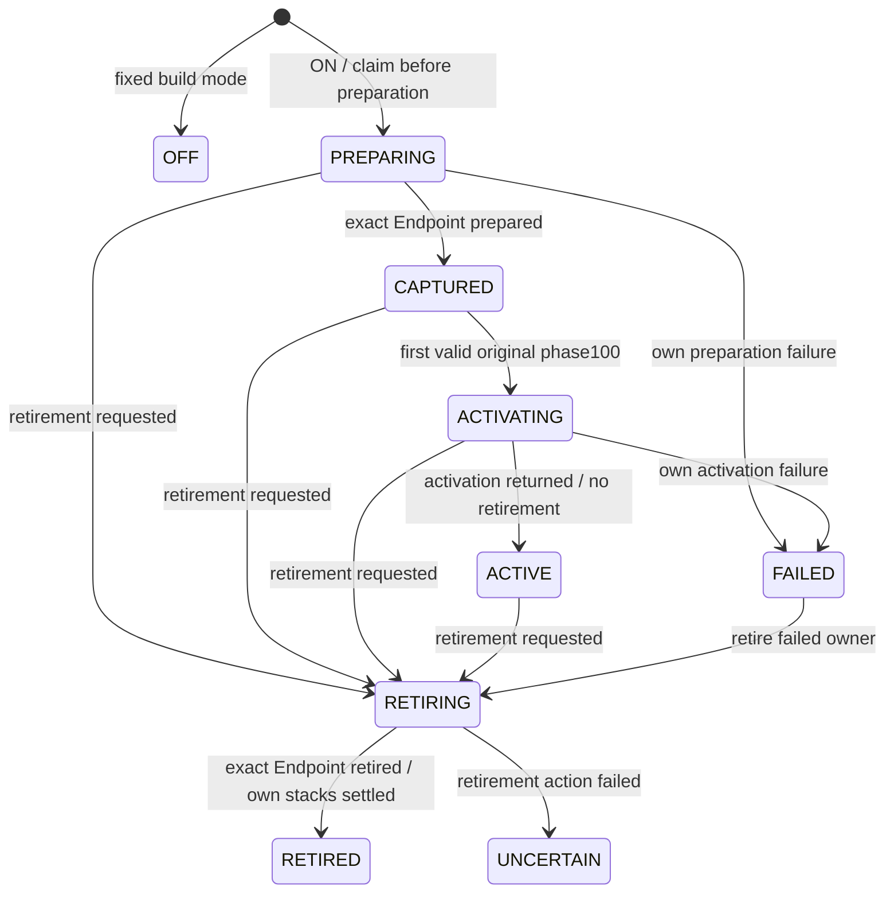

# Parent metrics cell: shared API decision gate

**Proposal only; no production cell or source hook is implemented.** This contract uses the original DMS parent transport and the frozen Producer/Endpoint. It contains no alias, publication candidate, ServiceManager registration/readback or publication-success API. Previous cards remain immutable. Root approval of these exact semantics is required before code.

[The inventory](../inventory/guest-metrics-parent-cell.json) pins the original factory/parent proofs and current authored components. The transition/race outcomes below are design obligations, not executed model tests. Actual source/code/loader/lifecycle/generation and Android/native behavior remain unaccepted.

## Proposed API

Public final authored class: `com.appleexploit.oneos.security.authority.PreparedGuestMetricsParentCell`. Its constructor is private. All arguments come from exact original-source hooks; Object/Binder identity comparisons detect misbinding, not authenticity. No caller supplies configuration, a source callback or an arbitrary target.

| Proposed method | Exact disposition |
| --- | --- |
| `static captureAfterOnStart(Object actualDms, Binder actualBorn): PreparedGuestMetricsParentCell` | OFF returns null without retaining either object. ON installs one strong class/loader claim **before** reflection/preparation. It prepares the frozen Producer/Endpoint once, outside the owner lock, and returns that claimed cell even if its preparation failed or retirement won. No getter invocation. Duplicate/conflicting claim or pre-claim retirement is refused with a fixed own-hook exception; it cannot replace the claim or clear an existing DMS field. |
| `static onOriginalBootPhaseCompleted(Object actualDms, int actualPhase): PhaseDisposition` | Other phases are ignored. Only matching owner, successful original phase100 and CAPTURED state can attempt one Endpoint activation. `ACTIVATION_APPLIED` requires normal Endpoint.activate return and a final nonretiring commit. Other results: `OFF`, `REFUSED_OWNER`, `REFUSED_ORDER`, `REFUSED_REPEAT`, `RETIRING`, `DISABLED_FAILURE`. None attests source, publication, metrics or Samsung readiness. |
| `dispatchFromParent(Object actualDms, Binder actualBorn, Parcel data, Parcel reply, int flags): boolean throws RemoteException` | Matching exact pair plus ACTIVE is required. Otherwise return unhandled false, without parsing data or claiming ABSENT. Admit/count a private dispatch frame, then call only the owned actual Endpoint's local `transact(1, data, reply, flags)` outside the owner lock. Return actual Boolean; propagate its actual exceptions. No fallback to original Stub for this private code. |
| `static retireForOwner(Object actualDms): RetirementDisposition` | Irreversibly closes parent/phase/capture admission for that owner and initiates at most the currently needed exact Endpoint.retire action. Returns `OFF`, `REFUSED_OWNER`, `PENDING`, `COMPLETE` or `UNCERTAIN`. It does not wait for preparation/activation/dispatch frames to disappear. No reset/recreate/retry. |
| `static retirementStatusForOwner(Object actualDms): RetirementDisposition` | Pure status poll with the same identity check and completion predicate; no Endpoint operation, retry, reflection or progress callback. |

These are proposed enums, not caller-provided Boolean decisions. Own preparation/activation failures use fixed dispositions without logging values or retaining a raw Throwable for a debug API. Direct dispatch preserves the frozen Endpoint's supported original failures/checked-fault cause behavior. No user-facing debug, dump, arbitrary-phase, target replacement, endpoint getter or reactivation API is proposed.

## Configuration and claim

Use one build-owned literal mode in this same future class, **OFF by default**, acquired once internally. An explicit OneOS candidate producer must generate/pin it with the exact helper closure and original/edited source profile. It is not a runtime property, SettingsProvider dependency, persistent toggle, UID check or attestation. No such producer exists yet. OFF performs no claim, preparation, capture, activation or metadata dispatch; ordinary DMS remains original.

The selected helper Class owns one slot: EMPTY, CLAIMED(cell), or CLOSED(owner). The slot is never cleared. It is one per admitted Class/loader, not a universal process singleton across duplicate loader images. The actual DMS field and this slot strongly retain the claimed objects and any preparation/activation/retirement uncertainty for process lifetime. No loader, service or DMS replacement is selected.

Retirement **before claim** must install a CLOSED tombstone for the actual owner, so a subsequent capture cannot activate. Returning COMPLETE merely because the DMS field is still null would be unsound: capture may have claimed the cell and be preparing before that field assignment. This is why retirement/status use the bounded class slot, rather than trusting the source field alone. Wrong-owner calls never take over or release a known claim. Source/currentness admission is still external; the public helper signature itself does not authenticate an arbitrary Object.

## State and open-stack ownership

Retirement is an irreversible overlay on PREPARING/ACTIVATING; those actual stacks may still be executing even after parent admission closes. No diagram edge cancels a stack or proves native drain. A failed cell never activates; the original pair/claim remains retained.

All admitted capture/preparation, phase/activation and parent dispatch frames acquire an own-use credit under the owner lock and release it in `finally`, after their external work and settlement checks. Retirement actions have a separate in-flight credit. Pure status and refused admission do not borrow the Endpoint and are not a drain credit. No owner lock is held across reflection, Producer/Endpoint construction, Endpoint.activate/retire/transact, Parcel operations or logging. No logging callback is needed.

An Endpoint returned by preparation is adopted into the claimed cell **before** that preparation credit is released. If retirement already won, it is never committed CAPTURED/ACTIVE; the preparing continuation claims the needed cleanup action and applies that exact Endpoint.retire outside the owner lock. There is no untracked late Endpoint. A preparation failure before an Endpoint is returned cannot activate one: activation is a separate admitted operation, and no reference is exposed by this API.

For valid phase100, commit ACTIVATING and its credit before calling Endpoint.activate. On return, commit ACTIVE only if retirement is still absent. If retirement won, suppress ACTIVE and ensure retirement of the exact Endpoint. If Endpoint.retire ran before activation, the frozen Endpoint refuses activation; if activation ran first, retirement closes it. In both orders the activation credit remains outstanding until that stack settles. Phase100 while preparation is incomplete is `REFUSED_ORDER`, terminally disables the attempted feature and closes further activation; it is not remembered for an automatic later activation. Original source order normally prevents this case. Repeated phase100 never calls activate again.

## Retirement completion and races

COMPLETE requires all of these under the owner lock:

- The slot/owner is terminally closed to capture, phase and parent admission.
- No admitted own-use frame or retirement action is in flight; preparation/activation can no longer produce or commit an active Endpoint.
- The exact retained Endpoint, if any, has a recorded **normal return from its own retire**. If none exists, no preparation stack remains that can create one.
- No retirement uncertainty is latched.

A cleanup action is claimed once for the exact Endpoint identity, executed outside the owner lock and acknowledged only on normal return. A late preparer is responsible for scheduling/performing the needed action for its newly adopted Endpoint. Polling does not repeat it. If retirement itself throws, retain uncertainty and owners; do not report COMPLETE or silently retry. Parent admission closes before the actual Endpoint reply fence is applied. A cell Boolean alone is not that fence.

| Race | Required outcome |
| --- | --- |
| Two captures | One claim wins; the other is refused. Never construct a second Producer/Endpoint or overwrite the DMS field on refusal. |
| Retire before capture/field store | Tombstone blocks claim, or the already claimed cell remains discoverable to retirement. Late field assignment can store only that same closed/retiring cell. |
| Retire during reflection/Endpoint preparation | PENDING until the preparing stack adopts/retires any returned Endpoint and exits. No late ACTIVE. |
| Phase100 during preparation | Refuse ordering and disable activation; no queued implicit retry. Retain/retire late prepared objects. |
| Retire during activation | Close admission; PENDING while activation is in flight. Final ACTIVE commit is forbidden; exact Endpoint retirement must settle. |
| Dispatch versus retirement | Close new parent calls, apply Endpoint.retire, retain admitted dispatch frames through actual local transact return/error. |
| Reply fence already crossed | Reply may still be written/delivered later. COMPLETE is own Java-stack completion, not native delivery or client consumption. |
| Failure/repeated event/retired owner | No reset, new owner, second activation, publication retry, default metrics or fake readiness. |

This completion contract covers the actual cell stacks and its nested Endpoint use. It does **not** drain original DMS, normal parent transactions, native Binder, callbacks, outer native reply delivery, other consumers or the process. Client parent-instance/epoch checks, original source lifetime and actual return drain remain separate.

## Exact future source hooks and failure regions

Keep `mOneOsGuestMetricsLifecycle` private/default-null on the actual DMS. No original constructor edit is required. After original onStart PC32 and before35, call the capture factory with original this and born v0, then store the returned cell. The own catch region covers only this added factory/store sequence; failure must not clear an existing cell or claim success. Original persistent-store, handler, cache, vendor and publication operations remain outside it.

After the original onBootPhase tail through111, before return114, guard on the actual phase100 argument and invoke `onOriginalBootPhaseCompleted(this, phase)`. The original default-display timeout, monitor/cleanup and vendor work remain outside the new own failure region and must propagate exactly. Never catch the entire original method to suppress an original failure. An optional helper/class-initialization/activation failure disables only the projection; bootstrap remains unready.

The existing BinderService.onTransact gets only the fixed `0x00fe0001` prefix **before** original PC0. Call package-private actual DMS `dispatchOneOsGuestMetricsFromParent(Binder,Parcel,Parcel,int)` through actual this$0; that method accesses its own cell and supplies actual owner plus actual born Binder. All other codes execute the identical original body, including Stub1…72 and vendor10111. The private dispatch has no catch-to-default contour: actual Endpoint reply/false/errors propagate. Canonical local Binder.transact resets borrowed data position0 and reply position0 on normal return as already frozen; do not add rewind/recycle/reset or a wrapper.

No alias/publication API or ServiceManager operation belongs in this variant. The frozen client still needs a separately source-approved fixed-code parent factory; no caller-supplied code. Fixed build ON, successful phase result, UID1000, descriptor, token, source names and the cell object are not actual endpoint/source/Samsung authority attestation.

## Producer and original-code gates before any edit

1. Pin the exact selected original/patched guest archives and relevant OneOS patches. Recheck collision, declared new field/method absence, source method/register/access/exception facts and actual defining-loader/helper closure. Never infer installed bytes from donor or patch intent.
2. Preserve **both original DMS constructors and actual BinderService constructor** unchanged, including original public Context factory path, Injector, captured owner field and PermissionEnforcer/Stub initialization. Do not invent a new DMS, eager backend or constructor enablement. New authored cell constructors stay private; disabled hooks create no Producer/Endpoint.
3. Change only the three selected original bodies and add the declared field/package-private dispatch method. Admit exact invocation descriptors/register budgets, parameter positions, branch/payload/try mappings and original failure edges; verify all nonprivate-code paths are original. No arbitrary object casts or hidden-method stubs.
4. Compare complete method/member/declaration/annotation/parameter/access/explicit initializer and **debug** data. Inserted prefixes/tails need exact original-PC/debug/try relocation and a genuine edited inverse. The bounded reader's reference proofs alone do not establish preservation of debug items.
5. Independently preserve numeric **raw hidden-API policy**, member identity/order and section presence across field/method insertion. A no-edit Samsung framework DEX repair profile cannot simply be copied onto edited ColorOS services. Do not default new/original policy flags, drop unknown map data or transplant an old raw section when member indices/counts changed. Selected DEX/container semantics, output limits/checksums and duplicate/foreign definition isolation require exact producer proof.
6. Bind the default-OFF literal and complete source/helper closure to the actual output manifest, without moving build receipts as inputs. Class/SDK compilation and authored race fixtures are later evidence, not ART/hidden-API/native/boot admission. No current producer, cell, source edit or test result closes these gates.

Root can approve this specific API/state contract or refine it before implementation. This card supplies a finite component contract, not a ready bootstrap: real parent/profile/currentness/loader/configuration, client mode, Samsung metrics computation and full GOAL remain open.
