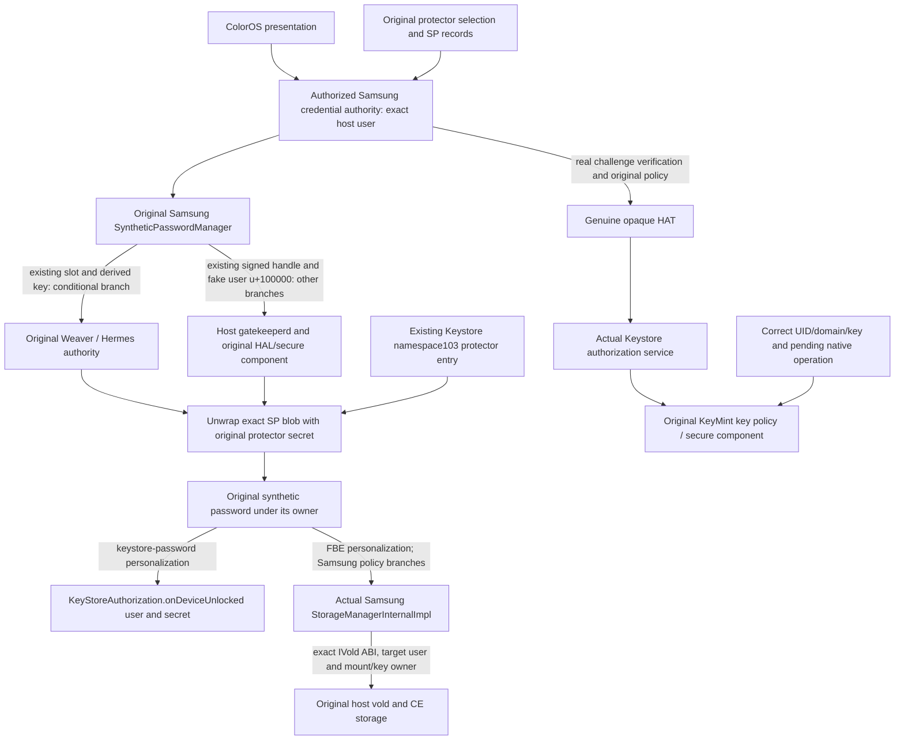

# Samsung credential storage, CE keys and hardware key authority

**Result: source-supported candidate boundaries only; no runtime or cryptographic acceptance.** Keeping the original credential means preserving the original host protector/SID, hardware enrollment and key authority. A Samsung service binary, a guest Android user0, or a successful ColorOS dismissal does not establish that ownership. The supplied OS capture contains none of the live private credential/key state needed to demonstrate continuity. No credential data, hardware token, key blob or actual SID was read or copied in this work.

Evidence is bounded to the exact Samsung services/framework archives,28 individually hash-verified OS files,228 selected Java bodies and one230-match direct IVold reference scan. The17 reader queries include declaration/body metadata and that reference scan; these are inspection counts, not security coverage. The services container has two DEX041 logical headers at0 and10057984, kept in its original full28157552-byte address space. [Derived inventory](../inventory/storage-keys.json) records exact hashes, methods, body hashes and ignored raw receipts. Native ELF imports/strings and init/VINTF declarations establish dependencies and configuration, not execution. **Verified runtime behavior in this investigation: none.**

## The identities must stay separate

| Identity | Observed source fact | Ownership consequence / missing evidence |
| --- | --- | --- |
| Android user `u` and profile/virtual-user classification | Samsung storage and LSS methods take the actual user; storage has a virtual-user path and DualDAR branches. | Guest user0 is not evidence that it denotes the original host user0 or the same storage/profile policy. Actual host user/profile metadata is absent. |
| LSKF-based Gatekeeper subject | `SyntheticPasswordManager.fakeUserId(u)` adds100000. | This is a Gatekeeper record selector, not a hardware SID, Linux UID or an isolated OneOS namespace. Two Android user0 authorities select the same numeric synthetic subject unless a reviewed boundary changes the ownership. |
| Hardware SID | `sidFromPasswordHandle` is a native boundary; protector creation can bind the key to that supplied nonzero SID. `verifyChallengeInternal` operates on the selected user's stored Gatekeeper handle. | The existing SID and valid signed handle must stay under the same authority. No SID value or handle is present in this OS-only capture. Numeric user-ID remapping does not recreate the SID. |
| Protector ID | `getProtectorKeyAlias` uses `synthetic_password_` plus hexadecimal protector ID; SP-state filenames use `%016x.%s`. | A newly generated protector/alias is not the existing host protector. The active protector selection, records and matching Keystore entry must agree. |
| Keystore APP identity | Framework key APIs address `KeyDescriptor`; supporting AOSP defines APP isolation by caller UID. OneOS intends ordinary guest app IDs to start15000. | The app-ID guard is producer intent, not a proof of disjoint host/guest UID allocations; fixed system UID1000 is still shared. It does not isolate system SELinux key namespaces. |
| Keystore SELinux namespace | The actual LSS constructor loads AndroidKeyStore with `AndroidKeyStoreLoadStoreParameter(103)` and assigns that store to SPM. Captured key contexts map103 to `locksettings_key` and100 to `vold_key`. | These are real shared system namespaces, not per-container paths. Loading a guest namesake service or copying its Java classes does not give it a private103. Access policy and the sole writer must be established. |
| Weaver slot / allocation mode | `PasswordSlotManager` uses `/metadata/password_slots/slot_map`; mode reads `ro.gsid.image_running`, with `host` for nonpositive values and a GSI label otherwise. | A different mount namespace or an image called a guest is not a slot allocation authority. Existing slot contents, key/value pairing and global ownership are absent. No slot was assigned, read or written. |
| Operation challenge and HAT | The actual HAT decoder populates challenge, user SID, authenticator ID/type, timestamp and MAC. Native `CreateOperationResponse.operationChallenge` supplies a real operation challenge when present. | A HAT is not a UI Boolean. Which real key/operation accepts it remains a cryptographic test, not a Java type/declaration fact. |

The APP/domain/SID semantics above are supported by [AOSP Keystore](https://source.android.com/docs/security/features/keystore) and [Gatekeeper](https://source.android.com/docs/security/features/authentication/gatekeeper); those descriptions do not establish Samsung runtime acceptance. In particular, trusted reenrollment can preserve a SID, while a fresh enrollment can create a new one. This report neither performs nor proposes performing an enrollment during this phase.

## Concrete data and authority graph

This is a conditional ownership graph, not a claim that Weaver and the fake-user Gatekeeper path both execute for every credential. Native daemon/HAL/secure-component internals and MAC acceptance remain open. The Java framework has a concrete token-forwarding path; `AuthTokenUtils` decodes bytes and `KeyStoreAuthorization.addAuthToken` forwards the structure through `IKeystoreAuthorization`. Gatekeeperd's actual ELF imports authorization interfaces and contains an AuthToken-forwarding failure diagnostic, but that is not a native control-flow or MAC-verification proof. Fingerprint/BiometricService token production/deposition is covered by the fingerprint/trust streams; their UI-success callbacks are not substituted for this graph.

## Actual private storage is missing from the dump

The strict mounted capture contains only `apex`, `odm`, `odm_dlkm`, `oem`, `product`, `system`, `system_dlkm`, `system_ext`, `vendor` and `vendor_dlkm`. It contains neither `/data` nor `/metadata`, nor `/mnt/vendor/efs` or secure hardware state. It is a mounted OS view, not a certified stock partition image or a credential backup.

| Required state | Exact source/path evidence | What this capture cannot establish |
| --- | --- | --- |
| Locksettings database and active protector selection | Samsung DatabaseHelper constructs Context-resolved `locksettings.db`, schema version3, and disables WAL in its constructor. Credential stream body SHA `35a3e4cc44501037ce308a94f82438a3f60e164932b11301ccd5e11a4ca24059`. | The actual runtime Context-resolved DB path, its rows, host user mapping and active/backup protector IDs. OneOS's staged `/data/system/locksettings.db` cleanup literal is not proof that a transplanted Context resolves the host database. |
| SP protector records | Normal Samsung path uses `Environment.getDataSystemDeDirectory(u)/spblob/`; virtual-user branch uses the data-system `users/u/spblob/` path. Files are protector-ID plus state suffix. | Password data/salts, signed handles, Weaver records, SP ciphertext and profile/escrow state. No actual record was opened. |
| Slot-allocation coordination | `/metadata/password_slots/slot_map`. | Existing labels, active slot numbers and contents. Its absence in the dump says nothing about whether the live phone uses Weaver. |
| Keystore entries and database | `keystore2` init passes `/data/misc/keystore`; Samsung init also manages `/data/system/users/keystore`. Namespace103 and alias routing are code facts. | Existing encrypted key blobs, super-key metadata, grants, key SID/auth policy and security level. Even the source's SID-bound protector creation policy does not prove the metadata of an existing runtime key. |
| Vold FBE/metadata state | Native vold contains `/data/misc/vold`, user-key paths under `/data/misc_ce`, and `/metadata/vold/metadata_encryption/` literals. | Actual CE/DE keys, installed kernel key state, wrappers, unlocked users and backing mount identity. Strings are not a complete native path/control-flow audit. |
| Samsung secure-service state | Hermes init passes `/data/vendor/gatekeeper`; declares `/mnt/vendor/efs/hermes` setup and secure-device node ownership. KeyMint init references vendor keymaster/provisioning directories. | Existing hardware provisioning, secure-element/TEE storage and per-boot token agreement. Static binaries are not those secrets or their live sessions. |

Code that can generate new state is not a source of the old state. No private state should be copied to create a second authority. A transplant candidate instead needs a reviewed way to retain/use the original authority and its existing protected records without divergent writers.

## Initialization and verification can write state

Observed Samsung source: `getWeaverServiceLocked` acquires the real service/config, calls `getUsedWeaverSlots`, then `PasswordSlotManager.refreshActiveSlots`. The latter removes current-mode mappings, updates active ones and saves the map. `getUsedWeaverSlots` enumerates all users' actual `weaver` protector records and contains Samsung virtual-user conflict mitigation that calls `destroyState`. Enabling this initializer against an empty or wrongly mapped guest data tree is therefore not an inert read-only attachment.

`verifyChallengeInternal` can act on `getShouldReEnroll`, perform genuine enrollment, save/sync the resulting handle and verify again. `unwrapSyntheticPasswordBlob` can recreate/upgrade an older blob. The credential stream additionally records security-integrity protector writes. Preserving the original credential is consequently an ownership/transactional policy requirement, not a promise that every legitimate host record stays byte-identical during verification. The existing OneOS enrollment/Weaver guards remain in force; no verification, reenrollment, slot allocation or HAL call occurred here.

The actual blob-creation body imports its protector AES key with critical-to-device-encryption policy; a nonzero supplied SID adds user-authentication binding and a15-second validity window. It attempts rollback-resistant import and has a non-rollback fallback. Unwrap uses the original alias's existing Keystore key. None of this proves the security level, policy or usability of the phone's current entry. `SyntheticPasswordCrypto.migrateLockSettingsKey` also has a real namespace migration path; namespace migration must not be run merely to make a guest lookup succeed.

## CE unlock and app-key authorization are different operations

Observed LSS source derives a Keystore-password-personalized SP subkey for `KeyStoreAuthorization.onDeviceUnlocked(user,secret)`. `initKeystoreSuperKeys` uses that personalization at the native maintenance boundary. `unlockCeStorage` derives the separate FBE personalization, includes Samsung DualDAR/user policy, obtains a Gatekeeper verification response, and selects whether to forward its HAT based on its real first-API/user branch. On a different branch it passes a null HAT. It first returns early if CE storage is already unlocked.

The actual concrete Samsung `StorageManagerService$StorageManagerInternalImpl.unlockCeStorage(I,[B,[B)` encodes the supplied HAT as hex, or the literal `!` when empty, then calls **`IVold.unlockCeStorage(I,String,[B,Z)`**, passing its `isHSUMMode`. It records the user in `mCeUnlockedUsers` and invalidates user/volume caches after that path; an unencrypted-storage branch can update those caches without invoking vold. The direct scan also finds LSS `setCeStorageProtection` calling **`IVold.setCeStorageProtection(I,[B,Z)`**, and the genuine create/destroy/lock key calls. These exact Samsung signatures and target owners must survive any adapter. Generic namesake/AOSP method matches are inadequate.

OneOS `guest_no_vold_keys.py` deliberately removes create/destroy/protect/unlock/lock calls while allowing surrounding Java to proceed. This is preservation behavior, not evidence that guest CE-key management succeeded. The `gvld` route in current `guest_start.sh` is conditional on a marker and matching patched binaries; the source still describes the unpatched ColorOS fallback registering `vold`. Current installed selection and actual Binder process ownership were not inspected in this phase.

Fresh app-key authentication has another boundary: `KeyStoreSecurityLevel.createOperation` receives the actual native operation challenge and handle. **`KeyStoreCryptoOperationUtils.getOrMakeOperationChallenge` returns a random long when the native challenge is absent.** A nonzero operation ID alone therefore does not prove a pending authentication-bound KeyMint operation. Auth parameters separately select SIDs, authenticator type, timeout, unlocked-device requirements and enrollment invalidation. Successful `addAuthToken`, an already authorized key, an already-unlocked CE user or a screen-dismissal callback cannot replace completion of the exact operation under its actual native key policy.

## Native process lifetime and import boundary

| Observed service declaration | Ownership implication; not a claim that it is currently running |
| --- | --- |
| Host `vold`: core/root; `shutdown critical`; `reboot_on_failure reboot,vold-failed`. | Preserve the original daemon, key/mount state and Binder names as the candidate baseline. Restarting/replacing it to simplify guest startup is outside this investigation and does not reconstruct CE state. Actual Binder/PID identity and the guest route remain acceptance requirements. |
| Host `keystore2`: early_hal, keystore UID, `/data/misc/keystore`, `critical window=0`; Samsung crypto/SQLite dependencies. | Retaining the native owner avoids inventing a second DB/super-key authority. Reuse still requires correct caller UID/SELinux namespace, current key metadata and real hardware acceptance. Starting a duplicate service/DB is not equivalent. |
| Host `gatekeeperd`: late_start/system, `/data/misc/gatekeeper`; Gatekeeper and authorization dependencies. | Keep the original Gatekeeper state/HAL route. A transplanted Java caller must address the correct user/handle/challenge and preserve throttle, reenrollment and recovery ownership. |
| Default KeyMint service: early_hal/system. SPU KeyMint service is disabled with SKU/board enable triggers. StrongBox NXP is disabled in its own RC. | Multiple files/instances exist; the running backend for a particular existing key is not determined by their presence. Preserve the actual security-level/session/provisioning owner. |
| NXP Weaver RC is disabled. Hermes is a separate hal/system daemon with Weaver AIDL/HIDL imports and `hwvault` symbols; VINTF declares Weaver/defaultv2 and Hermes command/default. | Hermes is a binary-supported provider candidate, not proof of the live Weaver Binder owner. Do not assume the NXP executable supplies the active service. Exact provider, secure storage and death/reconnection ownership remain open. |

Source-supported options remain open. A retained Samsung authority could leave these native owners and their original state in place while a separately authenticated ColorOS client submits bounded real requests. Importing real Samsung LSS/SPM into ColorOS instead requires the correct host storage/UserManager/profile/strong-auth/DAR graph, native Keystore/Gatekeeper/Vold routes and one state writer; a guest `LocalServices` object with the same Java name can still point at the wrong user tree or vold. Neither a whole Samsung framework nor a tiny broker has been established as mandatory or sufficient. An independent guest authority would require a genuinely disjoint credential/slot/UID/key namespace and a separately approved design; image names, chroot paths and appid15000 do not supply one.

## Smallest meaningful future acceptance, separately approved

1. Identify the actual host user/profile, original credential/protector/enrollment authorities and Binder/native process owners without exporting secrets. Confirm exact guest/native routes and the sole writer before enabling any guarded path. Preserve expected legitimate policy/reenrollment progress transactionally; never infer that no side effect occurred after an unreturned request.
2. Use a deliberately owned test key/app in the original host namespace, with verified native security level and per-use authentication policy. Establish that the exact pending operation cannot complete before fresh authentication. Confirm a real nonnull native operation challenge; the framework's random fallback is not acceptable evidence.
3. Have the approved ColorOS presentation cause genuine host verification for that exact subject/challenge. Do not log/export credential/SP/HAT/key material. Finish the same native operation and verify its public result. Negative controls must distinguish an older/different operation or a different UID/user/key and must account for authentication timeout/cache. No replay injection or production-key experiment is authorized now.
4. Separately prove correct CE access/protection for the intended original host storage owner, not just `mCeUnlockedUsers` or a no-op guest patch. Demonstrate host credential and existing owned app-key usability after return. User-performed cold-boot acceptance is a separate later gate; no reboot is requested or permitted by this report.

Native MAC/token consumption, secure-component sessions, actual key metadata, live process ownership, host/guest path mapping and post-return/cold-boot acceptance remain **missing evidence**. This report proposes evidence boundaries, not a phone procedure or authorization.

Reproduce retained static evidence with `python -B tools/audit_storage_keys.py`; `--refresh-java` reissues the exact inventory queries through the shared DEX041 reader. Raw OEM/native files remain only in ignored `firmware/storage-keys/`; generated receipts/logs remain ignored. No OEM class/JNI/service ran, and no phone, credential, slot, key or setting changed.
